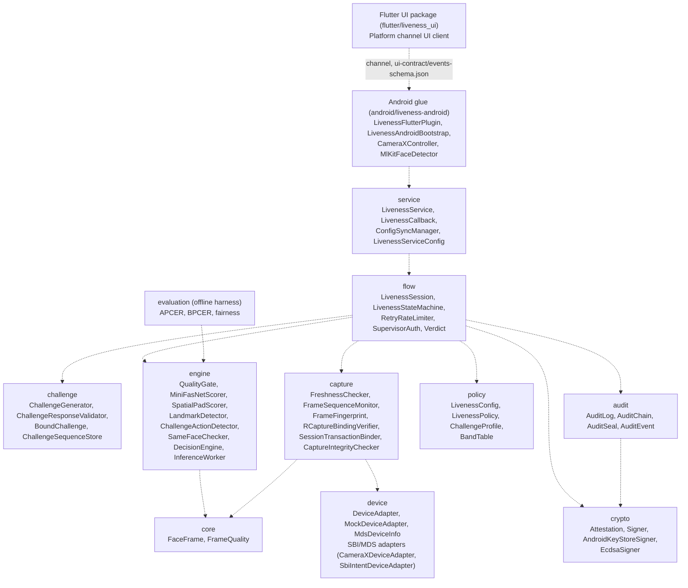

# MOSIP Face Liveness & Presentation Attack Detection (PAD)

**MOSIP Decode 2026 — Problem 04: Face Liveness + PAD**

A prototype Face Liveness and Presentation Attack Detection engine for the MOSIP biometric ecosystem (Registration Client & Android SBI), designed with ISO/IEC 30107-3 and CEN/TS 18099 in mind. It is not certified or compliance-tested.

**How it works:** a passive PAD model scores every frame that passes the quality gate. If the passive score is clearly bona fide, the session proceeds without an active challenge. The active challenge (blink, turn, look) runs when the passive score is uncertain, or when a replay loop is suspected. The smile detector is implemented but smile is not issued as a challenge.

**Host app:** the Android host app is DEV ONLY. It uses the host camera. If an SBI app is installed it detects it and switches to an SBI path with signature checking disabled; no real SBI or L0/L1 device was tested. It forces an active challenge on every session.

---

## MOSIP Decode 2026 Deliverables & Requirements Compliance Matrix

This project addresses **Problem Statement 04: Face Liveness Detection and Presentation Attack Detection for Registration and Biometric Authentication**. The table below details compliance against all mandatory (*) and optional deliverables specified in the *MOSIP Decode 2026 Submission Guidelines*:

| # | Submission Guideline Deliverable | Status | Location / Artifact | Description & Scope |
|---|---|---|---|---|
| 01 | **Source Code\*** | Complete | Repository root (`src/`, `android/`, `flutter/`, `tools/`) | Clean, modular, well-commented codebase across Java 11 core engine, Android modules (`:liveness-android`, `:host-app`, `:bench-app`), and Flutter client UI. |
| 02 | **Working Prototype or Demo\*** | Complete | `android/host-app`, `android/bench-app`, `flutter/liveness_ui` | Functional Android host application reading camera input with live quality gating, passive PAD scoring, active challenge state machine, and benchmark telemetry app. |
| 03 | **Pitch Presentation / Slide Deck\*** | Staged | Google Drive submission bundle | Slide deck covering problem statement, threat modeling, architecture, edge ML benchmarks, demographic fairness analysis, and ecosystem integration. |
| 04 | **Video Demo\*** | Staged | Google Drive submission bundle | 2–5 minute video demonstration illustrating live face positioning, passive evaluation, active challenge prompt/response, audit verification, and device failure handling. |
| 05 | **Design Mockups & Wireframes** | Complete | `ui-contract/events-schema.json`, `flutter/liveness_ui` | Formal JSON Schema specifying platform channel UI states, positioning feedback, challenge instructions, and user guidance flows. |
| 06 | **Architecture Diagram** | Complete | `reports/architecture.md` (and embedded below) | Detailed package-level and component interaction diagram detailing flow, engine, capture, policy, crypto, device adapters, and offline evaluation harness. |
| 07 | **Test Data** | Complete | `reports/bench-results/`, unit test synthetic vectors | Real on-device telemetry logs (thermal, lockstep, paced, YuNet, blur gate runs) and synthetic face frames across varying resolutions and qualities. |
| 08 | **Test Cases and Results** | Complete | `reports/TEST_REPORT.md` (651 tests, 0 failures) | Full unit, contract, and integration test suite executing 651 tests across 97 test classes with JaCoCo code coverage reporting. |
| 09 | **Usage and Installation Instructions\*** | Complete | `README.md` (see "Build & Test Instructions" below) | Step-by-step setup guides for building Java engine, running tests, compiling Android modules, installing host APK, and executing benchmark runs. |
| 10 | **API Documentation\*** | Complete | `README.md` (see "API Documentation & Integration Contracts") | End-to-end specifications for `LivenessService`, Android SBI Intent contract, MDS HTTP adapter endpoints, and UI platform channel events. |
| 11 | **Git Repository with Version History\*** | Complete | [GitHub: SiddharthaReddy018/zeroday](https://github.com/SiddharthaReddy018/zeroday) | Public Git repository with linear commit progression, milestone tags, and pull request reviews documenting project evolution. |
| 12 | **College/University Credentials\*** | Staged | Google Drive submission bundle | Valid student identification uploaded with the final submission package. |

---

## System Requirements & Prerequisites

To build, test, and deploy the solution across core engine, Android modules, and evaluation tools, the following toolchains and runtime prerequisites are required:

### 1. Build & Core Engine Toolchain
- **Java Development Kit (JDK)**: JDK 11 minimum; verified with OpenJDK 17, 21, and 25. The core Maven build targets Java 11 bytecode compatibility (`--release 11`).
- **Apache Maven**: Version 3.8.0 or higher (verified on Maven 3.9.11) for building the core library, running the JUnit 5 suite, and generating JaCoCo reports.

### 2. Android Build & Runtime Prerequisites
- **Android SDK**:
  - `compileSdkVersion`: **34** (Android 14)
  - `minSdkVersion`: **28** (Android 9.0 Pie)
  - `targetSdkVersion`: **31** for `:liveness-android` library; **34** for `:host-app` and `:bench-app`
  - Android SDK Build-Tools: **34.0.0**
  - Environment variable `ANDROID_HOME` or `ANDROID_SDK_ROOT` set (e.g. `export ANDROID_HOME="$HOME/Library/Android/sdk"`).
- **Gradle**: Gradle 8.5 with Android Gradle Plugin 8.2.2. The repository includes the `./gradlew` wrapper inside `android/`. Building Android modules requires `JAVA_HOME` pointing to JDK 17 (`export JAVA_HOME=$(/usr/libexec/java_home -v 17)` on macOS).
- **Android Debug Bridge (`adb`)**: Platform-Tools version 34+ (verified with `adb` 37.0.1) on system `PATH`.
- **Target Hardware / Device**: Physical Android device running Android 9.0+ (API 28+) with Developer Options and USB Debugging enabled. (Benchmarked and verified on Nothing A001, MediaTek MT6878, Android 15).

### 3. Machine Learning & Runtime Dependencies
- **ONNX Runtime**:
  - Desktop: `com.microsoft.onnxruntime:onnxruntime:1.16.3`
  - Android edge execution: `com.microsoft.onnxruntime:onnxruntime-android:1.16.3` AAR
- **Neural Models (Pinned Integrity)**:
  - MiniFASNetV2-SE INT8 quantized model (`MiniFASNetV2-SE-int8.onnx`, 612 KB, input 128x128 RGB) with hard SHA-256 integrity verification.
  - SFace Embedder model (112x112 BGR planar, 128-D embedding) with cosine distance threshold (0.48).
  - YuNet Face Detector model (640x640 letterbox, 5-point facial landmark alignment).

### 4. Optional Tooling & UI Clients
- **Python Toolchain (for `tools/` evaluation and calibration scripts)**: Python 3.9+ with `numpy`, `opencv-python`, and `onnxruntime` (`pip install numpy opencv-python onnxruntime`).
- **Flutter SDK (for `flutter/liveness_ui`)**: Flutter 3.x with Dart 3.x for running cross-platform UI widget unit tests.

---

## Repository Layout & Clone Structure

Per project organization standards, code and extended documentation are structured as follows:

```text
MOSIP/
├── face-liveness-pad/               # Code repository (zeroday / main)
│   ├── src/main/java/               # Core engine, audit, crypto, device & Android bridge
│   ├── src/test/java/               # Unit & integration test suites (651 tests at last run)
│   ├── android/                     # Android build root
│   │   ├── liveness-android/        # Android library module (CameraX, ONNX Runtime AAR, SBI glue)
│   │   ├── host-app/                # Interactive development harness APK
│   │   └── bench-app/               # On-device benchmark and telemetry APK
│   ├── flutter/liveness_ui/         # Flutter reference UI (cross-platform client screens)
│   ├── ui-contract/                 # JSON schema contracts for engine-UI platform channel
│   ├── tools/                       # Python calibration, parity validation, and benchmark scripts
│   ├── pom.xml                      # Maven project definition (Java 11, Surefire, JaCoCo)
│   ├── README-M4.md                 # Milestone 4 Android integration & benchmark report
│   └── reports/                    # Test report, architecture, design notes, bench results
```

> **Note:** The `docs/` folder in `face-liveness-pad` contains localized working copies and is strictly excluded from git tracking (`.gitignore`) to maintain repository hygiene.

---

## System Architecture

The following diagram illustrates the package-level relationships, service boundary, state flow, and security layers:



---

## Architectural Highlights

1. **Lightweight Neural PAD Scorer:**
   - Shipped with optimized INT8 quantized model (`MiniFASNetV2-SE-int8.onnx`, 612 KB).
   - Low-latency edge execution: **Mean: 8.80 ms, p50: 8.63 ms, p95: 11.34 ms, p99: 12.60 ms** (far exceeding the MOSIP 200 ms target by >17x).
   - Single-model decision architecture with strict `[0, 100]` probability score mapping and calibrated threshold bands (`PASS`, `UNCERTAIN`, `ATTACK`).

2. **SBI & MDS Device Adapters:**
   - **Android SBI Intent Adapter:** Spec-compliant (`io.sbi.device.Info`, `<appId>.rCapture`) with transaction ID nonce-binding, package allowlisting, and purpose validation.
   - **MDS HTTP Device Adapter:** Pure-Java standard `HttpURLConnection` client for desktop/remote MDS endpoints, supporting `/stream` and `/rCapture` with JWT verification.
   - **Multi-Hop JWT Verifier:** Enforces full X.509 certification path validation (`x5c`), intermediate CAs, `basicConstraints`, `keyCertSign`, leaf `digitalSignature`/`nonRepudiation`, and validity time windows against trusted root anchors.

3. **Cross-Stream Face Binding (`CrossStreamBinder`):**
   - Binds host camera live frames (T3) to peripheral SBI/MDS final captures (T1).
   - Integrates `SFaceEmbedder` (112×112 BGR planar, 128-D L2-normalized deep embeddings) with `SameFaceChecker` (calibrated cosine distance threshold: 0.48).
   - Normalizes timestamps across seconds/millis/micros/nanos/ISO-8601 and tolerates bounded clock skew (2000 ms).

4. **Cryptographic Attestation & Audit Trail:**
   - ECDSA P-256 digital signature over pipe-delimited canonical strings binding subject, session, image SHA-256, transcript hash, device tier, model version, and config version.
   - Supports both platform key stores (`AndroidKeyStoreSigner`) and custom signers via the `Signer` interface.
   - SHA-256 hash-chained audit log with terminal head sealing (`AuditSeal`), tamper detection, and export/import capabilities.

5. **Host Environment Integrity Checking:**
   - Heuristic root, Magisk, SU binary, Frida, Xposed, debugger, and emulator detection.
   - Profile-aware: `PRODUCTION` (disallows ADB and test-keys) vs `DEVELOPMENT` (allows ADB when configured, while still enforcing core integrity).

6. **ISO/IEC 30107-3 & Demographic Fairness Evaluation:**
   - Full evaluation harness computing APCER (per-species and worst-species), BPCER, and DET curves with 95% Wilson confidence intervals.
   - Fairness analyzer computing Monk Skin Tone, lighting, gender, and age category biases, adhering strictly to the **Rule of 30** (cells with <30 subjects are marked exploratory and excluded from conclusive bias deltas).
   - CEN/TS 18099 Injection Attack Detection (IAD) metric reporting (freeze, loop, nonce-swap).

---

## API Documentation & Integration Contracts

The project exposes defined API boundaries adhering to the MOSIP ecosystem specifications:

### 1. Core Java Engine Service API (`liveness.service`)
The primary programmatic interface for integrating face liveness verification into host applications:
- **`LivenessService`**: Initializes engine configuration, manages session life-cycle, and coordinates hardware adapters:
  ```java
  LivenessSession session = livenessService.createSession("subject-id-123", callback);
  session.start();
  session.submitFrame(faceFrame);
  ```
- **`LivenessSession`**: State-machine driver advancing frames through quality checks, passive inference, active challenges, and attestation.
- **`LivenessCallback`**: Asynchronous notification listener receiving session events:
  - `onStateChanged(LivenessState oldState, LivenessState newState)`
  - `onQualityFeedback(FrameQuality quality)`
  - `onChallengeIssued(Challenge challenge)`
  - `onComplete(Verdict verdict)`
  - `onError(LivenessError error)`
- **`Verdict`**: Final immutable result object containing:
  - `decision`: `BONA_FIDE`, `ATTACK_DETECTED`, `INCONCLUSIVE`, or `FAILED_MAX_RETRIES`
  - `compositeScore`: Calibrated `[0, 100]` probability score
  - `attestation`: Signed ECDSA P-256 cryptographic token
  - `auditTrail`: Sealed SHA-256 hash chain verifying tamper integrity

### 2. Android SBI Intent Contract (`io.sbi.*`)
Implements the MOSIP Android Secure Biometric Interface (Draft 0.9) over Android IPC:
- **Device Discovery (`io.sbi.device.Info`)**:
  - Action: `io.sbi.device.Info`
  - Response Extras: `deviceInfo` JSON payload containing device make, model, certification level (L0/L1), and capabilities.
- **Biometric Capture (`<appId>.rCapture`)**:
  - Action: `<targetAppId>.rCapture`
  - Request Extras:
    - `requestId`: Cryptographically random UUID nonce binding the session.
    - `purpose`: `Registration` or `Auth`.
    - `timeout`: Capture window timeout in milliseconds.
    - `biometricType`: `Face`.
  - Response Extras:
    - `status`: `SUCCESS`, `FAILED`, or `CANCELLED`.
    - `jwt`: Signed JWS containing biometric ISO 19794-5 face records and device attestation.
    - `errorCode`: Standard MOSIP device error code if unsuccessful.

### 3. MDS HTTP Device Adapter API
Pure-Java HTTP client (`liveness.desktop.MdsHttpDeviceAdapter`) implementing the MOSIP Biometric Device Specification 1.1.5:
- `GET /info`: Fetches device status, firmware version, and device key certificates.
- `GET /stream`: Subscribes to the live preview MJPEG video stream (T3) for real-time quality gating and passive PAD.
- `CAPTURE /rCapture`: Triggers secure biometric capture (T1), receiving signed JWT biometric data with multi-hop X.509 certificate path verification (`x5c`).

### 4. UI Platform Channel Contract (`ui-contract/events-schema.json`)
The Android/Flutter host communication contract defined by strict JSON schema:
- **`STATE_CHANGED`**: Emits engine state transitions (`IDLE`, `POSITIONING`, `PASSIVE`, `CHALLENGE`, `FINAL_CAPTURE`, `SUCCESS`, `FAILURE`).
- **`FEEDBACK`**: User positioning corrections (`MOVE_CLOSER`, `MOVE_AWAY`, `CENTER_FACE`, `IMPROVE_LIGHTING`, `HOLD_STEADY`).
- **`CHALLENGE`**: Active prompt instructions (`BLINK_TWICE`, `TURN_HEAD_LEFT`, `TURN_HEAD_RIGHT`, `LOOK_UP`, `LOOK_DOWN`).
- **`RESULT`**: Final verdict with score, signature, and audit record hash.

---

## Build & Test Instructions

### Step 1: Environment Setup
Verify your environment prerequisites:
```bash
# Verify Java version (must be JDK 11 or higher)
java -version
javac -version

# Verify Maven version (must be 3.8+)
mvn -version

# Set Android SDK path (required for Android builds)
export ANDROID_HOME="$HOME/Library/Android/sdk"
export PATH="$ANDROID_HOME/platform-tools:$PATH"
adb version
```

### Step 2: Running the Java Test Suite
The core test suite verifies the engine state machine, quality gates, active challenge detectors, cryptographic signing, audit sealing, and device adapters:
```bash
# Run all unit, contract, and integration tests
mvn test

# Run tests with JaCoCo code coverage report generation
mvn test jacoco:report
```
The suite executes **651 tests with 0 failures, 0 errors and 0 skipped** across 97 test classes (re-run `mvn test` to confirm). Code coverage reports are emitted to `target/site/jacoco/index.html`.

### Step 3: Testing Sub-Modules
Execute specific sub-module test suites:
```bash
# Evaluation harness and fairness metrics only
mvn test -Dtest='liveness.evaluation.*Test'

# Android SBI, CameraX, and platform channel tests only
mvn test -Dtest='liveness.android.*Test'

# Crypto and attestation tests only
mvn test -Dtest='liveness.crypto.*Test,liveness.audit.*Test'

# Capture and sequence monitors only
mvn test -Dtest='liveness.capture.*Test'
```

### Step 4: Flutter Reference UI (Optional)
```bash
cd flutter/liveness_ui
flutter pub get
flutter test
cd ../..
```

### Step 5: Android Library Build
To compile and test the Android library module (`:liveness-android`):
```bash
cd android
./gradlew :liveness-android:testDebugUnitTest
cd ..
```

---

## Run the host app (DEV ONLY)
The host app (`io.oxalpha.liveness.host`, Gradle module `:host-app`) is a development harness. It reads the phone camera directly. If an SBI app is installed it detects it and uses an SBI path with signature checking disabled; no real SBI or L0/L1 device was tested. It forces an active challenge on every session. Live observations so far come from one phone (Nothing A001, Android 15) and one person.

Prerequisites: Android SDK with `ANDROID_HOME` set, `adb` on PATH, and a phone with USB debugging enabled.
```bash
export ANDROID_HOME="$HOME/Library/Android/sdk"
cd android
./gradlew :host-app:installDebug
```
Then open the app from the phone launcher, allow camera access if asked, tap Start and face the camera. Behaviour, known limits and what was not verified on a device: see "Limitations" below and the live observations section of `reports/TEST_REPORT.md`.

These commands use the standard Android Gradle plugin task names. They were not re-run when this section was written.

---

## Android Bench App (device run)
Device used so far: Nothing A001 (MT6878, Android 15), one phone only. Release build.
```bash
export ANDROID_HOME="$HOME/Library/Android/sdk"
cd android
./gradlew :bench-app:installRelease
```
Bench outputs are written on the phone under
`/sdcard/Android/data/io.oxalpha.liveness.bench/files/bench/`.
`adb run-as` does not work on the release build; pull files with:
```bash
adb pull /sdcard/Android/data/io.oxalpha.liveness.bench/files/bench/ ./reports/bench-results/
```

---

## Offline Calibration & Parity Tools
Scripts in `tools/` validate model preprocessing parity and threshold calibrations:
```bash
# Check alignment parity between OpenCV and pure-Java implementations
python3 tools/check_align_parity.py

# Verify preprocessing tensor normalization parity
python3 tools/check_preprocessing_parity.py

# Calibrate same-face cosine distance threshold
python3 tools/calibrate_same_face.py
```

---

## Test Results
- Java suite: see "Running the Java Test Suite" above. Re-run `mvn test` to confirm the count on your machine.
- Device bench results, thermal readings and the relative blur-gate findings are in `reports/bench-results/` and `reports/design-notes/`.
- The relative blur gate is additive, default off, and not enabled by the app. Its constants
  (window 30, drop 2.0, y shift 1.5) are candidates, not fitted values.

---

## Limitations (Not verified)
- Only one phone, one lighting setup family and a few distances were measured. Other devices: not tested.
- Device observations are from one phone and one person; they are not accuracy figures.
- The host app forces a challenge on every session. The library default is passive-first, so host app runs do not show the passive-only path.
- SBI signature verification is disabled in the development paths (SbiJwtVerifier.disabledForDevelopment). No real SBI or L0/L1 device was connected.
- Presentation attack trials on the phone were run by the developer after the last engine fixes. Results are not logged in this repository and no detection rates are claimed.
  Can be integrated in (if necessary ).
- Cold-start DEVICE_FAILURE on the first Start after launch was seen in several captures; cause not verified. A later change tolerates one large first frame gap.
- Turn direction was verified from yaw captures only (own right gives negative yaw, own left positive) and unit tests. No confirmed on-device challenge turn.
- Blur gate margin is thin on the test phone. Blur limit is 100 (Laplacian variance). Frames that passed in one good capture measured about 101 to 156. In two other captures live frames measured a median of about 63 to 73, every frame was rejected, and the session stayed on PENDING (POSITIONING). Cause (lens, angle, distance, focus, light) is not verified. Keep the lens clean and hold steady in good light when demonstrating. The threshold was not loosened because no attack data supports a lower value.
- The latest clean release build was not re-verified on device after the last fixes; a live PASS was last observed on a debug build.
- Attack accuracy on real presentation attacks for the relative blur gate: not measured.
- Detector concurrent cost, signing integration, UI mapping of reason strings, and the
  `:liveness-android` compile in the full app: not verified in the bench sessions.
- Relative gate design holes: no reset after LOST or BLUR; the first 30 fed frames are blocked;
  a session that starts blurred is not caught; honest users changing light can be rejected;
  sessions with no samples bypass the check.
- ISO/IEC 30107-3 and CEN/TS 18099 wording in this README describes the metrics the harness computes.
  It is not a certification claim.

---

## References & Further Reading
- [README-M4.md](README-M4.md): Milestone 4 Android integration details, benchmark protocols, and wiring recipes.
- [reports/TEST_REPORT.md](reports/TEST_REPORT.md): Comprehensive test execution summary (651 tests) and demographic fairness report.
- [reports/architecture.md](reports/architecture.md): Full system architecture specification and package component graph.
- `ui-contract/events-schema.json`: Strict JSON schema contract for UI platform channel events.
- MOSIP Biometric Device Specification 1.1.5 & Android SBI Draft 0.9.
